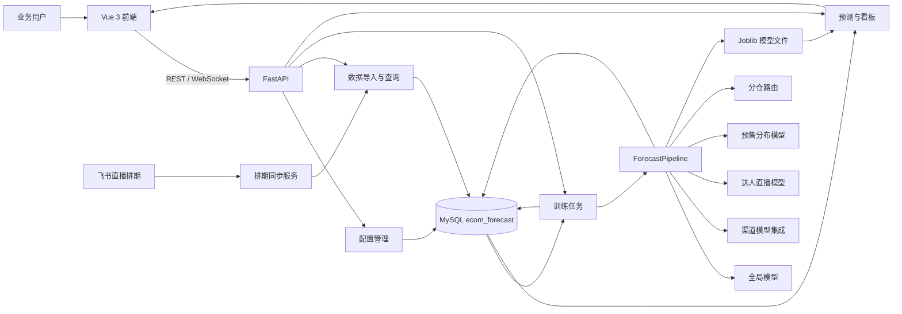
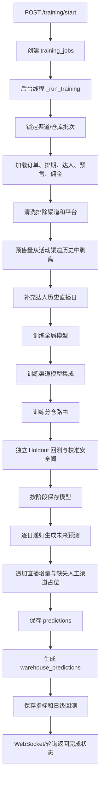

# BTN 物流单量预测系统：代码与数据地图

> 更新时间：2026-10-29  
> 适用目录：`ecom_forecast/`、`frontend/`  
> 目标：说明系统代码放在哪里、每个主要文件负责什么、数据如何从入库流向训练和看板。

## 当前事实数据入口（2026-10-29）

渠道、仓库及主播事实已切换为远端只读数据库直连，入口为 `api/services/query_source.py`。
渠道使用 `dwh_db_order_summary`，仓库使用 `ads_ofs_facility_order_daily_summary`，主播使用
`ads_dy_shop_live_features`。订单不复制到本地，不再选择上传批次；相关上传/保存/删除接口已关闭。
仓库按库存地点归并为逻辑仓，因源表没有店铺维度，仅学习整体分仓占比；回测同样按日期×逻辑仓比较。
主播实绩去重后按主播汇总，来源店铺名称不用于匹配系统店铺。排期、佣金、预售及预测结果仍保存在本地库。
连接参数通过服务端 `.env` / `DATA_QUERY_DB_*` 环境变量提供。详见项目根目录《数据库直连说明.txt》。
以下涉及渠道/仓库/主播上传及订单训练批次的段落仅描述旧版兼容结构，不再是当前的数据读取路径。

## 1. 系统全景

## 2. 核心业务口径

| 名称 | 计算口径 |
|---|---|
| 基础预测 | `base_predicted_orders`，由稳定/活动/联盟渠道模型根据历史订单、日期、活动、滞后及滚动特征生成 |
| 达人直播增量 | `anchor_predicted_orders`；人工排期填写 `expected_orders` 时直接采用，未填写时由达人历史模型估算 |
| 模型最终预测 | `predicted_orders = base_predicted_orders + anchor_predicted_orders` |
| 人工调整后预测 | `COALESCE(manual_predicted_orders, predicted_orders)` |
| 分仓预测 | 店铺渠道预测 × 店铺历史路由比例；单仓绑定店铺直接归入指定仓 |
| 实发单量 | `warehouse_orders.order_count`，用于仓级趋势、仓级回测和路由比例学习 |
| 客单价 | `channel_orders.payment_amount / channel_orders.order_count`，按查询维度聚合后计算 |
| 最新训练任务 | `training_jobs.status='done'` 且 `finished_at` 最新的任务 |

## 3. 目录地图

| 路径 | 主要职责 |
|---|---|
| `ecom_forecast/api/` | FastAPI、SQLAlchemy 模型、REST/WebSocket 接口、同步服务 |
| `ecom_forecast/src/` | 特征工程、预测模型、端到端流水线、预售修正、分仓路由 |
| `ecom_forecast/config/` | 活动日历、模型参数、路由规则及兼容配置 |
| `ecom_forecast/data/` | 文件数据读取、字段标准化、样例数据生成 |
| `ecom_forecast/evaluation/` | WAPE、MAPE、Bias、RMSE、MAE 和仓级评估 |
| `ecom_forecast/models/` | 已训练的 Joblib 模型文件，属于运行时产物 |
| `ecom_forecast/scripts/` | 回归测试、诊断、迁移、基准和验证脚本 |
| `frontend/src/` | Vue 3 页面、组件、Pinia 状态、Axios API 封装 |

## 4. 后端入口与基础设施

### `api/main.py`

- 创建 FastAPI 应用，默认使用 ORJSON 响应。
- 开启 GZip，压缩预测明细和排期表等大响应。
- 注册 `/api/config`、`/api/data`、`/api/training`、`/api/results`。
- 启动时执行数据库初始化，并启动飞书排期后台同步线程。
- 关闭时停止同步线程。
- 提供 `/api/health` 健康检查。

### `api/database.py`

- 定义 MySQL 连接池、`SessionLocal` 和 SQLAlchemy `Base`。
- 自动创建 `ecom_forecast` 数据库和缺失表。
- 对旧数据库执行兼容升级：补字段、补索引、移除重复旧索引。
- 回填和维护 `upload_batch_logs`，避免批次列表重复扫描大事实表。
- 当前数据库连接配置写在该文件中，生产环境建议迁移到环境变量或密钥服务。

### `api/models.py`

- 定义 20 张业务表对应的 SQLAlchemy ORM 模型。
- 配置主键、唯一约束、外键及查询索引。
- 表级详情见《数据库字典》。

### `api/schemas.py`

- 定义 FastAPI 请求与响应模型。
- 覆盖基础配置、训练请求、预测结果、评估指标、飞书绑定等接口结构。

## 5. 配置域代码

### `api/routers/config.py`

- 平台、渠道、店铺、仓库、大促日历的增删改查。
- `bootstrap` 一次返回前端初始化需要的完整配置。
- 维护渠道类型：`stable`、`event`、`affiliate`。
- 维护店铺单仓/多仓绑定与仓库启停状态。
- 管理飞书排期连接配置和“飞书表格 → 系统店铺”绑定。
- 导出训练可直接使用的配置快照。

### `config/routing_config.py`

- 保存或加载路由配置的兼容入口。
- 将数据库配置转换为模型层需要的仓库、店铺绑定和规则变更参数。

### `config/campaign_calendar.py` / `config/campaign_config.py`

- 定义活动期、预售期、活动类型和默认活动窗口。
- 为活动特征及预售识别提供规则。

### `config/model_config.py`

- 定义 LightGBM、训练窗口、特征和校准相关默认参数。

## 6. 数据导入与数据管理

### `api/channel_mapper.py`

- 把中文 Excel 列名映射为系统标准字段。
- 解析店铺名称/编码、平台别名和渠道别名。
- 标记无法自动映射、需要人工选择的渠道。

### `api/routers/data.py`

这是数据管理的主文件，主要逻辑包括：

1. **文件预览**：读取 Excel/CSV，自动映射字段并返回前 20 行。
2. **渠道订单保存**：标准化平台、清理同店多平台冲突、分块保存大文件。
3. **仓库订单保存**：支持大文件缓存和幂等分块写入。
4. **直播排期保存**：完整排期覆盖同一逻辑场次的旧空占位，保存后触发直播预测增量刷新。
5. **飞书排期同步入口**：读取同步状态并支持手动触发。
6. **达人实绩/预售/佣金保存**：负责格式校验、批次记录和唯一键处理。
7. **看板数据接口**：仓库日趋势、客单价趋势、数据量概览。
8. **批次与明细**：批次列表、游标分页明细、店铺搜索下拉。
9. **删除数据**：按批次、日期范围或全量删除，同时修正批次日志。

### `data/data_loader.py`

- 命令行/旧版应用使用的文件读取器。
- 读取渠道订单、仓库订单、直播排期和佣金文件。
- 应用列名映射、日期转换和必填字段校验。

### 批次选择规则

| 数据类型 | 训练/展示规则 |
|---|---|
| 渠道订单 | 训练任务锁定指定批次；未指定时使用最新有效批次 |
| 仓库订单 | 训练任务锁定指定批次；未指定时使用最新有效批次 |
| 直播排期 | 跨批次累积；同一逻辑场次保留最新完整记录，未来排期不会被历史推导记录覆盖 |
| 达人实绩 | 按唯一键累计维护，供达人模型训练 |
| 预售历史 | 按店铺、渠道、直播日、尾款日唯一维护 |
| 佣金 | 按上传批次读取，当前库可为空 |

## 7. 飞书直播排期链路

### `api/services/integration_settings.py`

- 使用 `system_settings` 保存飞书 App ID、密钥和同步参数。
- 敏感值加密后入库；对外接口只返回是否已配置，不返回明文密钥。

### `api/services/feishu_schedule_sync.py`

- 获取飞书租户令牌并读取多维表格记录。
- 按 `feishu_schedule_bindings` 将每张表绑定到系统店铺。
- 标准化开播时间、达人、渠道、目标 GMV、预估单量和 MCN。
- 每次同步只替换对应飞书来源的未来记录，不删除手工排期和历史排期。
- 保存同步批次并触发最新预测的直播增量刷新。
- 后台线程按配置间隔自动执行，也支持接口手动触发。

### `api/services/live_prediction_overlay.py`

- 不重训基础模型，只重新计算最新任务的直播增量。
- 加载最新 Joblib 模型和全部有效排期。
- 更新 `predictions` 的达人增量与最终预测。
- 重新路由并更新 `warehouse_predictions`。
- 适合排期新增或修改后的快速刷新。

## 8. 训练任务主链路

### `api/routers/training.py`

这是训练编排的主文件，核心流程如下：

关键逻辑：

- `_load_data_from_db`：按任务锁定批次加载训练数据；排期跨批次聚合。
- `_resolve_presale_allocations`：把预售历史量按实际活动渠道占比分配。
- `_merge_schedule_sources`：合并上传排期与历史推导预售排期。
- `_enrich_schedule_with_anchor_history`：把达人实绩转成历史直播特征，不推断未来排期。
- `_evaluate_holdout_before_forecast`：使用最近 N 天做独立回测。
- 校准安全阀：某渠道校准后 WAPE 变差时，回退到未校准稳定基线。
- 逐日递归：当天基础预测写回伪历史供下一天 lag/rolling 使用；达人增量不写回，避免直播影响向后扩散。
- `_build_manual_channel_placeholders`：只为预测中不存在的人工维护渠道补 0 单行，避免重复。
- 分阶段训练时加载未训练组件，并只保存本次训练组件，防止渠道单训覆盖分仓模型。

## 9. 模型与特征代码

### `src/pipeline/forecast_pipeline.py`

- 串联全局模型、渠道模型、达人模型和分仓路由。
- `train_global` / `predict_global`：店铺级总量模型。
- `train_channels` / `predict_channels`：渠道级模型和逐日递归预测。
- `train_routing` / `predict_warehouse`：学习并应用分仓比例。
- `evaluate_on_holdout`：渠道级和仓级评估。
- `restore_untrained_components`：分阶段训练时恢复已有模型组件。
- `save(phases=...)`：按训练阶段选择性保存，避免空模型覆盖。

### `src/models/base_model.py`

- `GlobalBaseModel`：店铺总量 LightGBM 基础模型。
- 汇总渠道订单到店铺日粒度。
- 构建时间、活动、店铺编码等特征。
- 对目标使用 `log1p`，预测后用 `expm1` 还原。
- 保存模型、特征列、编码器和店铺活动敏感度。

### `src/models/channel_models.py`

- `ChannelTypeModel`：单类渠道模型。
- `ChannelEnsemble`：按渠道类型分流并合并预测。
- `stable`：店铺、货架等稳定渠道，强化近期滚动基线。
- `event`：直播、活动等事件渠道，引入直播和预售特征。
- `affiliate`：联盟渠道，引入佣金率和联盟活跃度特征。
- 输出原始预测、校准预测、安全回退候选、基础预测和达人增量。
- 对显式人工排期渠道动态补预测行，但不重复已有组合。

### `src/models/anchor_live_model.py`

- 清洗并聚合 `anchor_live_orders`。
- 学习达人全局历史、达人×店铺历史、中位数和近期水平。
- 使用分层收缩，避免少样本达人预测过度极端。
- 同店、同日、同达人排期自动去除旧空占位和重复场次。
- 有 `expected_orders` 时直接作为直播增量；没有时使用历史模型估算。
- 从事件渠道历史标签中扣除达人实绩，避免基础模型和达人模型重复学习。

### `src/models/presale_model.py`

- 从历史直播日到尾款日的订单分布学习活动曲线。
- 按店铺、渠道、活动类型和日期间隔逐级回退。
- 估算活动总量并分配到尾款窗口每日。

### `src/adjustment/presale_adjuster.py`

- 旧版/辅助预售修正器。
- 根据 GMV、客单价、退款率计算净订单。
- 学习历史预售分布和倍率，并与基础模型融合。

### `src/routing/warehouse_router.py`

- 排除路由规则变化过渡期和临时路由日期。
- 只使用活跃仓历史数据学习店铺分仓比例。
- 单仓店铺按绑定直接归仓。
- 多仓店铺优先使用店铺历史比例；无店铺历史时使用全局比例；再无比例时才均匀兜底。
- 模型文件保存路由比例、活跃仓、绑定关系和规则日期。

### `src/features/time_features.py`

- 日期、星期、月份、季度、月初月末等日历特征。
- 按自然日生成 lag 和 rolling，避免把“上一条记录”误当“前一天”。
- 同比、节假日、调休和未来递归特征填充。

### `src/features/campaign_features.py`

- 将活动日历转换为活动事件。
- 生成活动前、活动中、活动后、距活动天数等特征。
- 计算店铺对活动的历史敏感度。

### `src/features/channel_features.py`

- 生成直播档位、达人、排期、佣金和预售相关特征。
- 预计算达人历史统计，供训练、回测和预测复用。

### `evaluation/metrics.py`

- 渠道和仓级的 WAPE、MAPE、Bias、RMSE、MAE。
- 整体 WAPE 按总绝对误差/总实际量计算，不对渠道 WAPE 做简单平均。

## 10. 结果与看板代码

### `api/routers/results.py`

- 查询指定任务或最新任务预测。
- `forecast-sheet` 返回平台×店铺×渠道×日期可编辑预测表。
- 保存人工调整到 `manual_predicted_orders`，不覆盖模型原值。
- 人工调整后重新生成对应分仓预测。
- 汇总基础预测、达人增量、模型预测、人工调整、评估指标。
- 提供总量/分仓历史回测趋势、仓库预测统计和 Excel 导出。
- 有效预测统一使用 `COALESCE(manual_predicted_orders, predicted_orders)`。

### `api/routers/data.py` 的看板接口

- `/warehouse-daily`：仓库每日实发趋势，默认最近 7 天。
- `/aov-daily`：客单价趋势，可按店铺、平台、渠道筛选，默认最近 7 天。
- `/overview`：源数据表数据量和日期范围概览。

## 11. 前端地图

### 页面

| 文件 | 路由 | 主要逻辑 |
|---|---|---|
| `frontend/src/views/Dashboard.vue` | `/dashboard` | 数据看板、仓库发货趋势、客单价趋势、预测与实发差距、快捷日期范围 |
| `frontend/src/views/DataManagement.vue` | `/data` | 文件上传、预览、分块保存、批次明细、手工直播排期、飞书同步配置 |
| `frontend/src/views/Configuration.vue` | `/config` | 平台渠道、店铺、仓库、活动日历及绑定配置 |
| `frontend/src/views/ModelTraining.vue` | `/training` | 选择训练阶段和数据批次、启动训练、显示日志和进度 |
| `frontend/src/views/LiveModelView.vue` | `/live-model` | 达人直播模型状态、直播增量、回测与口径说明 |
| `frontend/src/views/Results.vue` | `/results` | 预测汇总、渠道与仓库结果、评估指标、导出 |

### 组件与状态

| 文件 | 主要逻辑 |
|---|---|
| `frontend/src/components/FeishuForecastSheet.vue` | 平台/店铺/渠道可编辑预测表；展示基础量、直播增量、最终量和人工排期行 |
| `frontend/src/components/ForecastSheet.vue` | 通用预测表格展示与编辑 |
| `frontend/src/components/TrainingConsole.vue` | WebSocket 日志、进度和状态展示 |
| `frontend/src/components/AppLayout.vue` | 主布局和导航区域 |
| `frontend/src/components/SideBar.vue` | 路由菜单 |
| `frontend/src/stores/config.js` | 配置数据缓存与刷新 |
| `frontend/src/stores/training.js` | 训练任务、日志、进度、轮询与 WebSocket 状态 |
| `frontend/src/api/index.js` | Axios 封装、所有 REST API 和训练 WebSocket 工厂 |
| `frontend/src/router/index.js` | 六个业务页面路由及页面标题 |

## 12. 数据血缘矩阵

| 业务输出 | 主要输入表 | 代码入口 | 输出表/文件 |
|---|---|---|---|
| 仓库实发趋势 | `warehouse_orders` | `api/routers/data.py::warehouse_daily` | API JSON |
| 客单价趋势 | `channel_orders` | `api/routers/data.py::aov_daily` | API JSON |
| 渠道未来预测 | `channel_orders`、`live_schedules`、`anchor_live_orders`、`presale_history`、`commissions` | `api/routers/training.py` → `ForecastPipeline` | `predictions` |
| 分仓未来预测 | `predictions`、`warehouse_orders`、`shops`、`warehouses` | `WarehouseRouter` | `warehouse_predictions` |
| 历史回测趋势 | 渠道/仓库历史 + Holdout 预测 | `_save_backtest_daily_results` | `backtest_daily_results` |
| 模型指标 | Holdout 明细 | `_save_evaluation_metrics` | `evaluation_metrics` |
| 人工预测调整 | `predictions` | `results.py::update_forecast_sheet` | `predictions.manual_predicted_orders` + 重算 `warehouse_predictions` |
| 直播快速刷新 | `live_schedules` + 已训练模型 | `live_prediction_overlay.py` | 更新 `predictions`、`warehouse_predictions` |
| Excel 导出 | 预测、仓级预测、指标 | `results.py::export_excel` | `.xlsx` 下载 |

## 13. 模型文件地图

| 文件 | 内容 |
|---|---|
| `models/global_model.joblib` | 店铺总量模型、特征列、编码器、活动敏感度 |
| `models/channel_models/stable_model.joblib` | 稳定渠道模型与校准参数 |
| `models/channel_models/event_model.joblib` | 活动/事件渠道模型与预售模型 |
| `models/channel_models/affiliate_model.joblib` | 联盟渠道模型 |
| `models/channel_models/anchor_live_model.joblib` | 达人历史统计、店铺达人统计、直播渠道映射 |
| `models/channel_models/channel_type_map.joblib` | 渠道到模型类型映射 |
| `models/warehouse_router.joblib` | 店铺分仓比例、全局比例、仓库和绑定配置 |

## 14. 测试与诊断入口

| 文件 | 覆盖范围 |
|---|---|
| `scripts/test_algorithm_regressions.py` | 时间特征、直播、预售、递归预测、校准、分仓路由等核心算法 |
| `scripts/test_data_save_regressions.py` | 数据上传、平台清洗、大文件分块、排期覆盖旧占位 |
| `scripts/test_api_query_regressions.py` | 最新批次、结果汇总、看板查询 |
| `scripts/test_config_regressions.py` | 基础配置增删改与约束 |
| `scripts/test_forecast_sheet_adjustments.py` | 预测表人工修改与分仓联动 |
| `scripts/test_feishu_schedule_sync.py` | 飞书排期同步和来源隔离 |
| `scripts/diagnose_forecast_bias.py` | 预测偏差诊断 |
| `scripts/benchmark_detail_query.py` | 大批次明细查询性能 |

## 15. 常见问题定位

| 现象 | 优先检查 |
|---|---|
| 最新预测不对 | `training_jobs` 最新完成任务、任务 `phases`、`config_snapshot.training_data_batches` |
| 某仓预测异常高 | `warehouse_router.joblib` 的店铺比例、全局比例、活跃仓和单仓绑定 |
| 直播量重复 | `live_schedules` 同店同日同达人、`predictions` 同任务同店同渠道同日重复组合 |
| 人工排期未生效 | `expected_orders`、排期日期是否在预测窗口、达人名称和渠道是否有效 |
| 看板与模型结果不同 | 是否存在 `manual_predicted_orders`；看板使用人工调整后的有效值 |
| 客单价为空 | `channel_orders.payment_amount` 是否有值、订单量是否大于 0 |
| 单独训练后其他模型丢失 | 检查 `restore_untrained_components` 和 `save(phases=...)` 是否生效 |
| 修改代码未生效 | 当前 Uvicorn 未使用 `--reload` 时需要重启 API 服务 |
