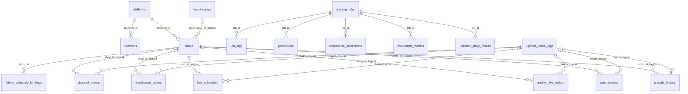

# BTN 物流单量预测系统：数据库字典

> 数据库：MySQL `ecom_forecast`  
> 字符集：`utf8mb4`  
> 结构来源：2026-10-19 实际运行库 `information_schema` + `api/models.py`  
> 表数量：20

## 1. 表分类与数据量快照

| 分类 | 表名 | 当前行数 | 用途 |
|---|---|---:|---|
| 配置 | `platforms` | 39 | 平台主数据 |
| 配置 | `channels` | 70 | 平台渠道及模型类型 |
| 配置 | `shops` | 176 | 店铺主数据及分仓绑定 |
| 配置 | `warehouses` | 16 | 仓库主数据 |
| 配置 | `campaign_calendar` | 12 | 大促/活动日历 |
| 配置 | `system_settings` | 4 | 系统集成配置和密钥 |
| 配置 | `feishu_schedule_bindings` | 1 | 飞书表格与店铺绑定 |
| 原始数据 | `channel_orders` | 760,893 | 店铺渠道日订单与付款金额 |
| 原始数据 | `warehouse_orders` | 433,844 | 店铺渠道仓库日实发单量 |
| 原始数据 | `live_schedules` | 104 | 直播/预售排期 |
| 原始数据 | `anchor_live_orders` | 6,271 | 达人直播历史实发 |
| 原始数据 | `commissions` | 0 | 联盟佣金月度数据 |
| 原始数据 | `presale_history` | 261 | 预售直播日到尾款日历史 |
| 运维 | `upload_batch_logs` | 44 | 数据上传批次汇总 |
| 训练 | `training_jobs` | 47 | 训练任务主表 |
| 训练 | `job_logs` | 1,116 | 训练日志 |
| 结果 | `predictions` | 288,749 | 渠道日预测 |
| 结果 | `warehouse_predictions` | 558,172 | 仓库日预测 |
| 结果 | `evaluation_metrics` | 540 | 模型评估指标 |
| 结果 | `backtest_daily_results` | 804 | 日级预测与实发回测 |

> 行数是文档生成时快照，会随上传、训练和清理发生变化。

## 2. 关系总览



### 实际外键

| 子表字段 | 父表字段 | 删除行为 |
|---|---|---|
| `channels.platform_id` | `platforms.platform_id` | CASCADE |
| `shops.platform_id` | `platforms.platform_id` | SET NULL |
| `feishu_schedule_bindings.shop_id` | `shops.shop_id` | RESTRICT |
| `job_logs.job_id` | `training_jobs.job_id` | CASCADE |
| `predictions.job_id` | `training_jobs.job_id` | CASCADE |
| `warehouse_predictions.job_id` | `training_jobs.job_id` | CASCADE |
| `evaluation_metrics.job_id` | `training_jobs.job_id` | CASCADE |
| `backtest_daily_results.job_id` | `training_jobs.job_id` | CASCADE |

其余 `shop_id`、`warehouse_id`、`upload_batch` 为逻辑关联，运行库未全部建立物理外键，以降低大批量写入和历史兼容成本。

## 3. 通用字段与枚举

### 通用字段

| 字段 | 含义 |
|---|---|
| `id` | 自增物理主键 |
| `shop_id` | 店铺业务编码，如 `CS07` |
| `platform` / `platform_id` | 平台编码，如 `TM`、`DOUYIN` |
| `channel` / `channel_id` | 渠道编码或业务名称，如“店铺”“达播” |
| `warehouse_id` | 仓库业务编码，如 `WH01`、`HZ04` |
| `upload_batch` / `batch_id` | 数据上传批次标识 |
| `job_id` | 训练任务 UUID |
| `created_at` | 记录创建时间 |

### 常用枚举

| 字段 | 取值 |
|---|---|
| `channel_type` | `stable` 稳定渠道；`event` 活动/直播；`affiliate` 联盟 |
| `maintenance_mode` | `manual` 手工维护；`auto` 自动维护 |
| `campaign_mode` | `auto` 自动判断；`on` 强制参与；`off` 强制不参与 |
| `binding_type` | `single` 单仓绑定；`multi` 多仓路由 |
| `event_type` | `live` 普通直播；`presale_payment` 预售尾款日 |
| `source_type` | `manual` 手工/文件；`feishu:*` 飞书同步来源 |
| `training_jobs.status` | `pending`、`running`、`done`、`error` |
| `backtest_daily_results.level` | `total` 总量；`warehouse` 分仓 |
| `time_source` | `exact` 真实上传时间；`inferred` 从历史明细推断 |

## 4. 配置表

### 4.1 `platforms` — 平台主数据

| 字段 | 类型 | 空 | 默认 | 说明 |
|---|---|---|---|---|
| `id` | int | 否 | 自增 | 主键 |
| `platform_id` | varchar(64) | 否 | — | 平台业务编码，唯一 |
| `name` | varchar(128) | 否 | — | 平台名称 |
| `created_at` | datetime | 是 | — | 创建时间 |
| `maintenance_mode` | varchar(16) | 否 | `manual` | 配置维护方式 |

约束与索引：`PRIMARY(id)`；`UNIQUE(platform_id)`。

### 4.2 `channels` — 平台渠道配置

| 字段 | 类型 | 空 | 默认 | 说明 |
|---|---|---|---|---|
| `id` | int | 否 | 自增 | 主键 |
| `platform_id` | varchar(64) | 否 | — | 所属平台，外键到 `platforms` |
| `channel_id` | varchar(64) | 否 | — | 平台内渠道编码 |
| `name` | varchar(128) | 是 | — | 渠道显示名称 |
| `created_at` | datetime | 是 | — | 创建时间 |
| `channel_type` | varchar(16) | 否 | `stable` | 模型类型 |
| `include_in_forecast` | tinyint(1) | 否 | `1` | 是否参与模型训练和预测 |
| `maintenance_mode` | varchar(16) | 否 | `manual` | 配置维护方式 |

约束与索引：`PRIMARY(id)`；`UNIQUE(platform_id, channel_id)`。

### 4.3 `shops` — 店铺配置

| 字段 | 类型 | 空 | 默认 | 说明 |
|---|---|---|---|---|
| `id` | int | 否 | 自增 | 主键 |
| `shop_id` | varchar(64) | 否 | — | 店铺业务编码，唯一 |
| `name` | varchar(128) | 是 | — | 店铺名称 |
| `platform_id` | varchar(64) | 是 | — | 所属平台，外键到 `platforms` |
| `campaign_mode` | varchar(16) | 是 | — | 活动参与模式 |
| `created_at` | datetime | 是 | — | 创建时间 |
| `binding_type` | varchar(16) | 否 | `multi` | `single` 单仓或 `multi` 多仓 |
| `warehouse_id` | varchar(64) | 是 | — | 单仓绑定时的指定仓库 |
| `effective_date` | date | 是 | — | 仓库绑定生效日期 |
| `maintenance_mode` | varchar(16) | 否 | `manual` | 配置维护方式 |

约束与索引：`PRIMARY(id)`；`UNIQUE(shop_id)`；索引 `platform_id`。  
备注：ORM 定义了 `warehouse_id → warehouses.warehouse_id`，当前运行库以逻辑关系使用。

### 4.4 `warehouses` — 仓库配置

| 字段 | 类型 | 空 | 默认 | 说明 |
|---|---|---|---|---|
| `id` | int | 否 | 自增 | 主键 |
| `warehouse_id` | varchar(64) | 否 | — | 仓库业务编码，唯一 |
| `name` | varchar(128) | 是 | — | 仓库名称 |
| `region` | varchar(64) | 是 | — | 所属区域 |
| `created_at` | datetime | 是 | — | 创建时间 |
| `is_active` | tinyint(1) | 是 | `1` | 是否参与未来分仓 |

约束与索引：`PRIMARY(id)`；`UNIQUE(warehouse_id)`。

### 4.5 `campaign_calendar` — 活动日历

| 字段 | 类型 | 空 | 默认 | 说明 |
|---|---|---|---|---|
| `id` | int | 否 | 自增 | 主键 |
| `name` | varchar(128) | 否 | — | 活动名称 |
| `start_date` | date | 否 | — | 活动开始日 |
| `end_date` | date | 否 | — | 活动结束日 |
| `campaign_type` | varchar(64) | 是 | — | 活动类型，如 `618`、`1111` |
| `created_at` | datetime | 是 | — | 创建时间 |

约束：`PRIMARY(id)`。

### 4.6 `system_settings` — 系统设置

| 字段 | 类型 | 空 | 默认 | 说明 |
|---|---|---|---|---|
| `id` | int | 否 | 自增 | 主键 |
| `namespace` | varchar(64) | 否 | — | 配置命名空间 |
| `setting_key` | varchar(128) | 否 | — | 配置键 |
| `setting_value` | text | 是 | — | 配置值；敏感值加密存储 |
| `is_secret` | tinyint(1) | 否 | — | 是否为密钥 |
| `updated_at` | datetime | 是 | — | 更新时间 |

约束与索引：`PRIMARY(id)`；`UNIQUE(namespace, setting_key)`。

### 4.7 `feishu_schedule_bindings` — 飞书排期表绑定

| 字段 | 类型 | 空 | 默认 | 说明 |
|---|---|---|---|---|
| `id` | int | 否 | 自增 | 主键 |
| `name` | varchar(128) | 是 | — | 绑定名称 |
| `shop_id` | varchar(64) | 否 | — | 对应系统店铺，外键到 `shops` |
| `base_token` | varchar(128) | 否 | — | 飞书多维表格 Base Token |
| `table_id` | varchar(128) | 否 | — | 飞书 Table ID，唯一 |
| `enabled` | tinyint(1) | 否 | — | 是否启用自动同步 |
| `created_at` | datetime | 是 | — | 创建时间 |
| `updated_at` | datetime | 是 | — | 更新时间 |

约束与索引：`PRIMARY(id)`；`UNIQUE(table_id)`；索引 `shop_id`。

## 5. 原始业务数据表

### 5.1 `channel_orders` — 渠道日订单

粒度：日期 × 店铺 × 平台 × 渠道 × 上传批次。

| 字段 | 类型 | 空 | 默认 | 说明 |
|---|---|---|---|---|
| `id` | int | 否 | 自增 | 主键 |
| `date` | date | 否 | — | 订单日期 |
| `shop_id` | varchar(64) | 否 | — | 店铺编码 |
| `platform` | varchar(64) | 是 | — | 平台编码 |
| `channel` | varchar(64) | 否 | — | 渠道 |
| `order_count` | int | 是 | — | 订单量 |
| `is_sample` | tinyint(1) | 是 | — | 是否派样/样品订单 |
| `upload_batch` | varchar(64) | 是 | — | 上传批次 |
| `created_at` | datetime | 是 | — | 入库时间 |
| `payment_amount` | float | 是 | — | 付款金额，用于客单价 |

主要索引：

- `ix_channel_orders_date_channel_orders(date, channel, order_count)`
- `ix_channel_orders_channel_orders(channel, order_count)`
- `ix_channel_orders_shop_date(shop_id, date)`
- `ix_channel_orders_batch_created(upload_batch, created_at)`
- `ix_channel_orders_batch_id(upload_batch, id)`
- `ix_channel_orders_batch_shop_id(upload_batch, shop_id, id)`

### 5.2 `warehouse_orders` — 仓库日实发

粒度：日期 × 店铺 × 渠道 × 仓库 × 上传批次。

| 字段 | 类型 | 空 | 默认 | 说明 |
|---|---|---|---|---|
| `id` | int | 否 | 自增 | 主键 |
| `date` | date | 否 | — | 发货/履约日期 |
| `shop_id` | varchar(64) | 否 | — | 店铺编码 |
| `platform` | varchar(64) | 是 | — | 平台编码 |
| `channel` | varchar(64) | 是 | — | 渠道 |
| `warehouse_id` | varchar(64) | 否 | — | 实际发货仓标识 |
| `order_count` | int | 是 | — | 实发单量 |
| `is_sample` | tinyint(1) | 是 | — | 是否派样 |
| `upload_batch` | varchar(64) | 是 | — | 上传批次 |
| `created_at` | datetime | 是 | — | 入库时间 |

主要索引：

- `ix_warehouse_orders_date_warehouse_orders(date, warehouse_id, order_count)`
- `ix_warehouse_orders_shop_date(shop_id, date)`
- `ix_warehouse_orders_batch_created(upload_batch, created_at)`
- `ix_warehouse_orders_batch_id(upload_batch, id)`
- `ix_warehouse_orders_batch_shop_id(upload_batch, shop_id, id)`

### 5.3 `live_schedules` — 直播与预售排期

粒度：一条直播场次或一条预售尾款事件。

| 字段 | 类型 | 空 | 默认 | 说明 |
|---|---|---|---|---|
| `id` | int | 否 | 自增 | 主键 |
| `shop_id` | varchar(64) | 否 | — | 店铺编码 |
| `date` | date | 否 | — | 直播日；预售记录为尾款日 |
| `has_live` | tinyint(1) | 是 | — | 是否有直播 |
| `event_type` | varchar(32) | 否 | `live` | `live` 或 `presale_payment` |
| `broadcast_date` | date | 是 | — | 预售记录对应直播日 |
| `anchor_tier` | varchar(32) | 是 | — | 达人档位 A/B/C |
| `expected_viewers` | int | 是 | — | 预估观看人数 |
| `upload_batch` | varchar(64) | 是 | — | 上传/同步批次 |
| `created_at` | datetime | 是 | — | 入库时间 |
| `anchor_name` | varchar(128) | 是 | — | 主播/达人名称 |
| `expected_orders` | float | 是 | — | 人工预估单量；存在时直接作为直播增量 |
| `expected_revenue` | float | 是 | — | 预估 GMV |
| `session_type` | varchar(32) | 是 | — | 专场、混场等 |
| `platform` | varchar(32) | 是 | — | 平台编码 |
| `mcn` | varchar(128) | 是 | — | MCN 机构 |
| `scheduled_at` | datetime | 是 | — | 精确开播时间 |
| `source_type` | varchar(32) | 是 | — | `manual` 或飞书来源标识 |
| `source_record_id` | varchar(128) | 是 | — | 外部来源记录 ID，用于幂等 |
| `channel` | varchar(64) | 是 | — | 直播增量归属渠道 |

主要索引：

- `ix_live_schedules_shop_date(shop_id, date)`
- `ix_live_schedules_source_time(source_type, scheduled_at)`
- `ix_live_schedules_batch_created(upload_batch, created_at)`
- `ix_live_schedules_batch_id(upload_batch, id)`
- `ix_live_schedules_batch_shop_id(upload_batch, shop_id, id)`

业务去重：有外部记录 ID 时按来源记录识别场次；无 ID/时间时，同店、同日、同达人视为同一逻辑场次，完整记录覆盖旧空占位。

### 5.4 `anchor_live_orders` — 达人直播历史实发

| 字段 | 类型 | 空 | 默认 | 说明 |
|---|---|---|---|---|
| `id` | int | 否 | 自增 | 主键 |
| `date` | date | 否 | — | 直播日期 |
| `anchor_name` | varchar(128) | 否 | — | 达人名称 |
| `shop_id` | varchar(64) | 是 | — | 店铺编码 |
| `order_count` | int | 是 | — | 达人实际带货单量 |
| `upload_batch` | varchar(64) | 是 | — | 上传批次 |
| `created_at` | datetime | 是 | — | 入库时间 |

约束与索引：

- `UNIQUE(date, anchor_name, shop_id)`
- `ix_anchor_live_orders_batch_created(upload_batch, created_at)`
- `ix_anchor_live_orders_batch_id(upload_batch, id)`
- `ix_anchor_live_orders_batch_shop_id(upload_batch, shop_id, id)`

### 5.5 `commissions` — 联盟佣金月度数据

| 字段 | 类型 | 空 | 默认 | 说明 |
|---|---|---|---|---|
| `id` | int | 否 | 自增 | 主键 |
| `shop_id` | varchar(64) | 否 | — | 店铺编码 |
| `month` | varchar(8) | 否 | — | 月份，如 `202610` |
| `commission_rate` | float | 是 | — | 佣金率 |
| `active_affiliates` | int | 是 | — | 活跃联盟/达人数量 |
| `upload_batch` | varchar(64) | 是 | — | 上传批次 |
| `created_at` | datetime | 是 | — | 入库时间 |

主要索引：`ix_commissions_shop_month(shop_id, month)` 及三个批次查询索引。

### 5.6 `presale_history` — 预售历史

| 字段 | 类型 | 空 | 默认 | 说明 |
|---|---|---|---|---|
| `id` | int | 否 | 自增 | 主键 |
| `shop_id` | varchar(64) | 否 | — | 店铺编码 |
| `channel` | varchar(64) | 是 | — | 活动渠道 |
| `broadcast_date` | date | 否 | — | 定金/直播日 |
| `payment_date` | date | 否 | — | 尾款日 |
| `order_count` | int | 是 | — | 尾款日订单量 |
| `campaign_type` | varchar(32) | 是 | — | 活动类型 |
| `upload_batch` | varchar(64) | 是 | — | 上传批次 |
| `created_at` | datetime | 是 | — | 入库时间 |

约束与索引：

- `UNIQUE(shop_id, channel, broadcast_date, payment_date)`
- `ix_presale_history_payment_channel(payment_date, channel)`
- 三个批次查询索引。

### 5.7 `upload_batch_logs` — 上传批次汇总

| 字段 | 类型 | 空 | 默认 | 说明 |
|---|---|---|---|---|
| `id` | int | 否 | 自增 | 主键 |
| `data_type` | varchar(32) | 否 | — | `channel`、`warehouse`、`schedule`、`commission`、`anchor`、`presale` |
| `batch_id` | varchar(64) | 否 | — | 批次标识 |
| `row_count` | int | 否 | — | 当前批次实际剩余行数 |
| `data_start` | date | 是 | — | 数据最早日期 |
| `data_end` | date | 是 | — | 数据最晚日期 |
| `source_filename` | varchar(255) | 是 | — | 来源文件/同步来源说明 |
| `uploaded_at` | datetime | 否 | — | 上传完成时间 |
| `time_source` | varchar(16) | 否 | — | `exact` 或 `inferred` |

约束与索引：`UNIQUE(data_type, batch_id)`；`ix_upload_batch_logs_type_time(data_type, uploaded_at)`。

## 6. 训练任务表

### 6.1 `training_jobs` — 训练任务

| 字段 | 类型 | 空 | 默认 | 说明 |
|---|---|---|---|---|
| `id` | int | 否 | 自增 | 主键 |
| `job_id` | varchar(64) | 否 | — | 任务 UUID，唯一 |
| `status` | varchar(32) | 是 | — | 任务状态 |
| `phases` | json | 是 | — | 本次阶段，如 `["global","channel","routing"]` |
| `config_snapshot` | json | 是 | — | 训练时完整配置和锁定批次 |
| `progress` | int | 是 | — | 0–100 进度 |
| `error_msg` | text | 是 | — | 失败信息 |
| `started_at` | datetime | 是 | — | 开始时间 |
| `finished_at` | datetime | 是 | — | 完成时间 |
| `created_at` | datetime | 是 | — | 创建时间 |

主要索引：`UNIQUE(job_id)`；`ix_training_jobs_status_finished(status, finished_at)`；`ix_training_jobs_created(created_at)`。

`config_snapshot` 重点键：

- `platforms`、`shops`、`warehouses`
- `channel_type_map`
- `shop_warehouse_binding`
- `campaign_calendar`
- `excluded_channels`
- `training_data_batches.channel`
- `training_data_batches.warehouse`

### 6.2 `job_logs` — 训练日志

| 字段 | 类型 | 空 | 默认 | 说明 |
|---|---|---|---|---|
| `id` | int | 否 | 自增 | 主键 |
| `job_id` | varchar(64) | 否 | — | 训练任务外键 |
| `log_text` | text | 是 | — | 日志文本 |
| `log_level` | varchar(16) | 是 | — | `info`、`warning`、`error` |
| `created_at` | datetime | 是 | — | 记录时间 |

索引：`ix_job_logs_job_created(job_id, created_at)`。删除任务时级联删除。

## 7. 预测结果表

### 7.1 `predictions` — 渠道日预测

粒度：任务 × 日期 × 店铺 × 平台 × 渠道。

| 字段 | 类型 | 空 | 默认 | 说明 |
|---|---|---|---|---|
| `id` | int | 否 | 自增 | 主键 |
| `job_id` | varchar(64) | 否 | — | 训练任务外键 |
| `date` | date | 否 | — | 预测日期 |
| `shop_id` | varchar(64) | 否 | — | 店铺编码 |
| `channel` | varchar(64) | 否 | — | 渠道 |
| `platform` | varchar(64) | 是 | — | 平台 |
| `predicted_orders` | float | 是 | — | 模型最终预测 |
| `created_at` | datetime | 是 | — | 创建时间 |
| `raw_predicted_orders` | float | 是 | — | 原始/未最终校准预测，用于审计 |
| `manual_predicted_orders` | float | 是 | — | 人工调整值；非空时优先展示和分仓 |
| `adjustment_note` | varchar(255) | 是 | — | 人工调整备注 |
| `adjusted_at` | datetime | 是 | — | 人工调整时间 |
| `base_predicted_orders` | float | 是 | — | 不含达人直播的基础预测 |
| `anchor_predicted_orders` | float | 是 | — | 达人直播增量 |

计算关系：

```text
predicted_orders = base_predicted_orders + anchor_predicted_orders
effective_orders = COALESCE(manual_predicted_orders, predicted_orders)
```

主要索引：

- `ix_predictions_job_date_channel_orders(job_id, date, channel, predicted_orders)`
- `ix_predictions_job_date_shop_channel(job_id, date, shop_id, channel)`
- `ix_predictions_job_platform_shop_channel_date(job_id, platform, shop_id, channel, date)`
- `ix_predictions_job_shop_date(job_id, shop_id, date)`

### 7.2 `warehouse_predictions` — 仓库日预测

粒度：任务 × 日期 × 店铺 × 渠道 × 仓库。

| 字段 | 类型 | 空 | 默认 | 说明 |
|---|---|---|---|---|
| `id` | int | 否 | 自增 | 主键 |
| `job_id` | varchar(64) | 否 | — | 训练任务外键 |
| `date` | date | 否 | — | 预测日期 |
| `shop_id` | varchar(64) | 否 | — | 店铺编码 |
| `channel` | varchar(64) | 是 | — | 渠道 |
| `warehouse_id` | varchar(64) | 否 | — | 目标仓库 |
| `warehouse_orders` | float | 是 | — | 分仓预测量 |
| `sample_orders` | float | 是 | — | 兼容旧版派样字段，当前通常为 0 |
| `created_at` | datetime | 是 | — | 创建时间 |

主要索引：

- `ix_wh_predictions_job_date_wh_orders(job_id, date, warehouse_id, warehouse_orders)`
- `ix_wh_predictions_job_wh_orders(job_id, warehouse_id, warehouse_orders)`

### 7.3 `evaluation_metrics` — 评估指标

| 字段 | 类型 | 空 | 默认 | 说明 |
|---|---|---|---|---|
| `id` | int | 否 | 自增 | 主键 |
| `job_id` | varchar(64) | 否 | — | 训练任务外键 |
| `level` | varchar(32) | 是 | — | `overall`、`channel`、`warehouse`、`anchor` 等 |
| `group_key` | varchar(128) | 是 | — | `all`、渠道名、仓库名等 |
| `mae` | float | 是 | — | 平均绝对误差 |
| `rmse` | float | 是 | — | 均方根误差 |
| `mape` | float | 是 | — | 平均绝对百分比误差 |
| `bias` | float | 是 | — | 偏差比例或兼容值 |
| `created_at` | datetime | 是 | — | 创建时间 |
| `wape` | float | 是 | — | 加权绝对百分比误差 |
| `n_samples` | int | 是 | — | 样本数 |
| `total_actual` | float | 是 | — | 实际总量 |
| `total_predicted` | float | 是 | — | 校准后预测总量 |
| `raw_wape` | float | 是 | — | 原始预测 WAPE |
| `raw_mape` | float | 是 | — | 原始预测 MAPE |
| `raw_bias` | float | 是 | — | 原始预测 Bias |
| `raw_rmse` | float | 是 | — | 原始预测 RMSE |
| `raw_total_predicted` | float | 是 | — | 原始预测总量 |

索引：`ix_evaluation_metrics_job_level(job_id, level)`。

### 7.4 `backtest_daily_results` — 日级回测明细

| 字段 | 类型 | 空 | 默认 | 说明 |
|---|---|---|---|---|
| `id` | int | 否 | 自增 | 主键 |
| `job_id` | varchar(64) | 否 | — | 训练任务外键 |
| `date` | date | 否 | — | 回测日期 |
| `level` | varchar(32) | 否 | — | `total` 或 `warehouse` |
| `group_key` | varchar(128) | 否 | — | `all` 或仓库编码 |
| `actual_orders` | float | 否 | — | 实际单量 |
| `predicted_orders` | float | 否 | — | 历史模拟预测量 |
| `created_at` | datetime | 是 | — | 创建时间 |

约束与索引：

- `UNIQUE(job_id, date, level, group_key)`
- `ix_backtest_job_level_date(job_id, level, date)`
- `ix_backtest_job_group_date(job_id, group_key, date)`

## 8. 关键查询口径

### 最新有效预测任务

```sql
SELECT *
FROM training_jobs
WHERE status = 'done'
ORDER BY finished_at DESC
LIMIT 1;
```

### 人工调整后的有效预测

```sql
SELECT COALESCE(manual_predicted_orders, predicted_orders) AS effective_orders
FROM predictions;
```

### 客单价

```sql
SELECT date,
       SUM(payment_amount) / NULLIF(SUM(order_count), 0) AS avg_order_value
FROM channel_orders
WHERE upload_batch = :latest_batch
GROUP BY date;
```

### 仓库实际单量

```sql
SELECT date, warehouse_id, SUM(order_count) AS actual_orders
FROM warehouse_orders
WHERE upload_batch = :latest_batch
GROUP BY date, warehouse_id;
```

### 检查预测重复组合

```sql
SELECT job_id, date, shop_id, platform, channel, COUNT(*) AS row_count
FROM predictions
GROUP BY job_id, date, shop_id, platform, channel
HAVING COUNT(*) > 1;
```

### 检查直播排期影子记录

```sql
SELECT old.*
FROM live_schedules old
WHERE old.event_type = 'live'
  AND old.channel IS NULL
  AND old.expected_orders IS NULL
  AND EXISTS (
      SELECT 1
      FROM live_schedules complete
      WHERE complete.shop_id = old.shop_id
        AND complete.date = old.date
        AND complete.event_type = old.event_type
        AND complete.anchor_name = old.anchor_name
        AND complete.id <> old.id
        AND (complete.channel IS NOT NULL OR complete.expected_orders IS NOT NULL)
  );
```

## 9. 数据治理建议

- 为 `predictions(job_id,date,shop_id,platform,channel)` 增加唯一约束前，先完成历史重复数据审计。
- 仓库历史中的中文仓名和配置仓库编码应建立统一映射，避免路由训练过滤有效历史。
- `DATABASE_URL` 应迁移到环境变量，并轮换当前硬编码凭据。
- 金额字段长期建议从 `FLOAT` 升级为 `DECIMAL(18,2)`，降低累计精度误差。
- `channel_orders` 和 `warehouse_orders` 数据量继续增长时，可按日期或批次分区归档。
- 所有大表查询应优先带 `upload_batch`、`job_id`、日期或店铺条件，避免全表扫描。
- 直播排期应尽量提供 `source_record_id` 或 `scheduled_at`，以准确区分同一达人同日多场直播。

